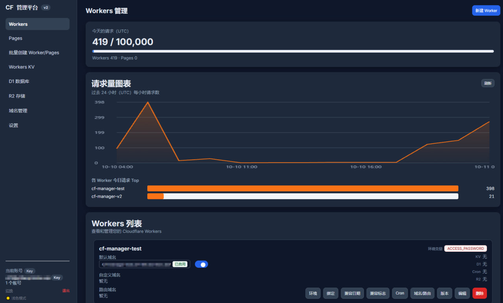
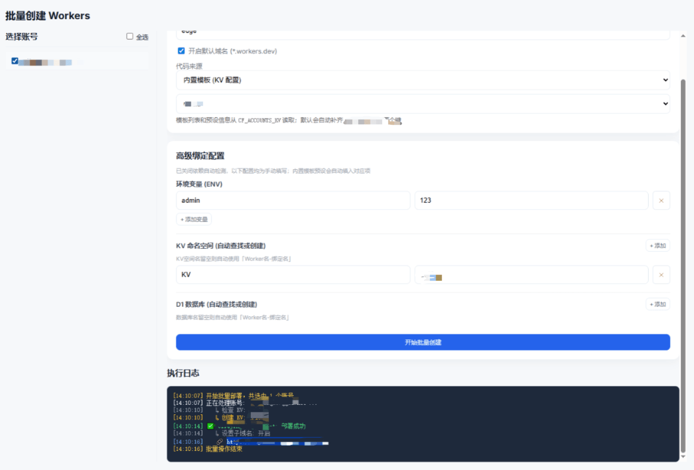
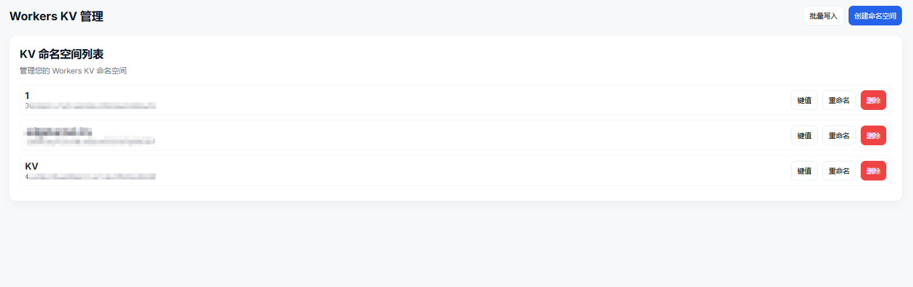
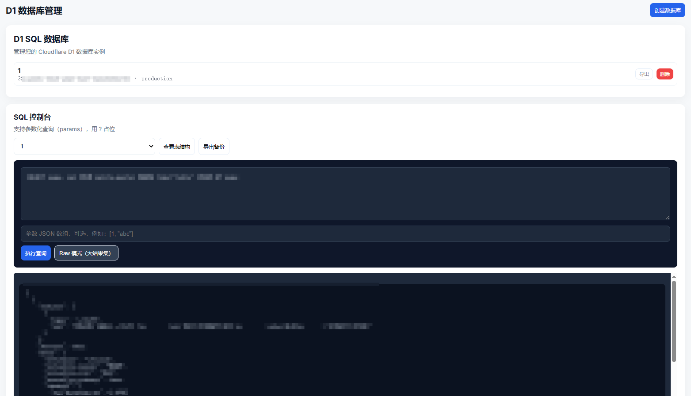
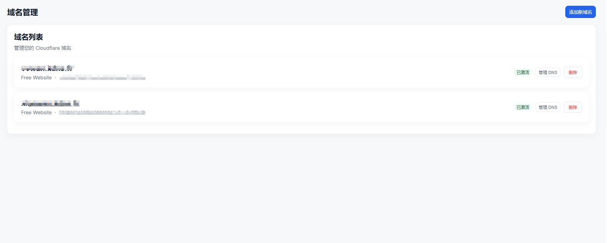
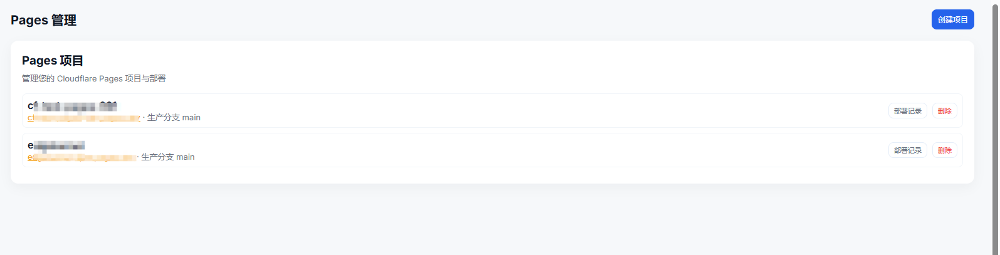
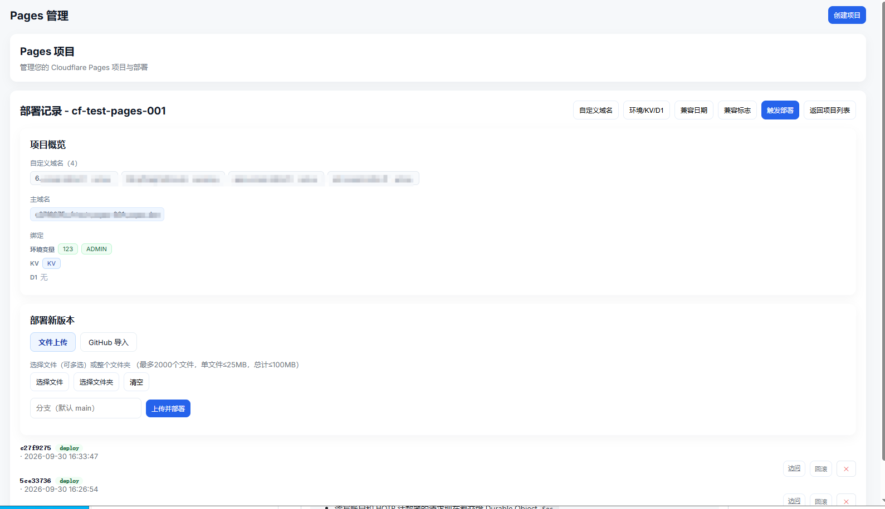
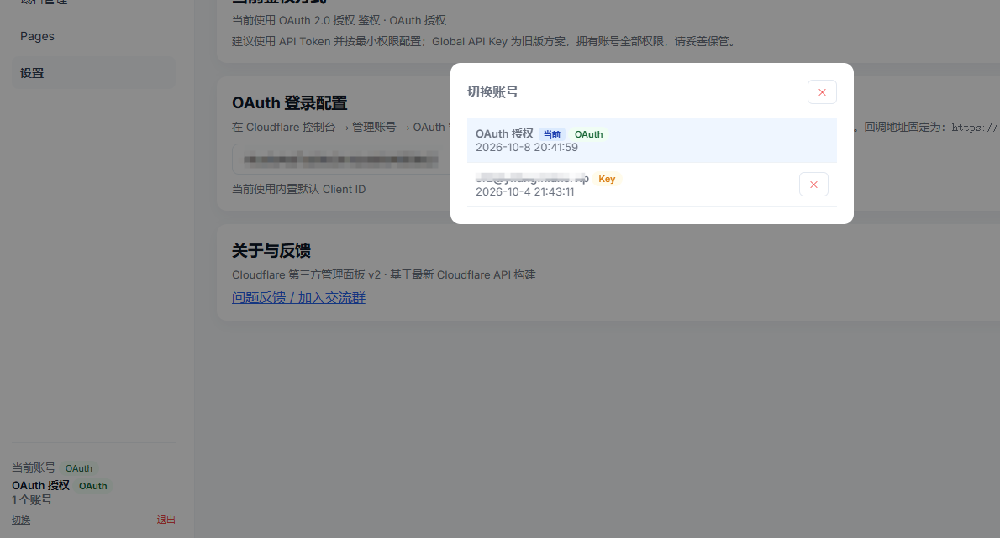

# Cloudflare 管理面板（单文件 Worker）

> 一个 540 KB 的 Cloudflare Module Worker，自带前端，部署后即可管理自己账号下的
> Workers / KV / D1 / R2 / Pages / DNS / 隧道，并带用量统计。
> 所有 Cloudflare API 请求都由 Worker 后端代理，浏览器不直连 `api.cloudflare.com`。

**版本**：v2.9.0 ｜ **形态**：单文件发布，无构建步骤 ｜ **许可证**：MIT

---

## 目录

- [它是什么](#它是什么)
- [功能](#功能)
- [功能截图](#功能截图)
- [快速开始](#快速开始)
- [配置项](#配置项)
- [需要哪些权限](#需要哪些权限)
- [安全模型](#安全模型)
- [测试](#测试)
- [已知限制](#已知限制)
- [参与贡献](#参与贡献)

---

## 它是什么

一个跑在 Cloudflare Workers 上的自托管面板。整个项目就是**一个 `.js` 文件**，
前端 HTML/CSS/JS 内嵌在同一个文件里，后端用同一份代码把请求转发到 Cloudflare API。

```
浏览器 ──HTTPS──> Worker（本面板）──HTTPS──> api.cloudflare.com
                    │
                    ├─ 校验访问密码 / 会话
                    ├─ 注入调用方的 API Token / Global Key
                    └─ 返回 JSON 给内嵌前端
```

这样做的好处：**没有 CORS 问题**、不需要额外的前端托管、部署只有一个文件。
代价：所有 API 调用都要经过 Worker，受 Workers 的子请求数与 CPU 时间限制（见[已知限制](#已知限制)）。

---

## 功能

### Workers
- 列表、部署 / 编辑 / 删除，经典脚本与 ES Module 都支持
- workers.dev 子域名开关、账号级自定义域名（绑定 / 解绑 / 列表）
- 环境变量（文本 / 密钥 / JSON）、Secrets 批量增删改
- KV / D1 / R2 绑定，兼容性日期与兼容性标志
- Cron 定时触发器、Worker 路由（Route）管理
- 版本列表与回滚（Versions API）

### 隧道（Cloudflare Tunnel）
- 新建 / 列表 / 详情 / 删除
- 建隧道时自动写 ingress 规则 + 自动创建 CNAME 解析，失败自动回滚
- 规则编辑支持「子域名 + 主域名」下拉选择，带实时预览
- 删除隧道时连带清理对应 CNAME

### 批量创建
- 多账号批量部署 Worker / Pages
- 内置模板存于 KV（`CF_ACCOUNTS_KV`），也支持直链 / ZIP / 粘贴代码
- 自动查找或创建 KV / D1 并绑定
- GitHub 仓库链接自动识别并查找 `_worker.js`
- 执行日志逐条回显

### KV / D1 / R2 / Pages / DNS
- **KV**：命名空间 CRUD（含 jurisdiction）、键分页与前缀搜索、单键读写删（TTL）、批量写删
- **D1**：创建 / 列表 / 删除、参数化查询、Raw 模式、导出备份
- **R2**：存储桶管理（jurisdiction / 存储类型）、对象列表与上传删除、预签名下载链接、
  一键换取临时 S3 凭证、r2.dev 开关、自定义域名、数据目录（Iceberg）、运营指标
- **Pages**：项目与部署管理、直接上传 / ZIP / GitHub 导入、高级模式（`_worker.js`）、
  绑定与环境变量（生产 + 预览）、兼容性设置、自定义域名（自动补 CNAME）
- **DNS**：Zone 管理、记录 CRUD 与批量导入、Zone 分析（请求 / 流量 / 国家分布、可筛选）

### 用量与鉴权
- KV / D1 / R2 三个页面的用量卡（GraphQL 聚合，共享缓存）
- Workers 今日请求、按 Worker 排行、24 小时时间序列
- Token 权限自检（7 项探针，含 DNS 记录级探测）
- 鉴权三选一：OAuth 2.0 + PKCE（推荐）、API Token、Global API Key

---

## 功能截图

| Workers 管理 | 批量创建 Worker |
|---|---|
|  |  |

| Workers KV | D1 数据库 |
|---|---|
|  |  |

| 域名 / DNS | Pages 管理 |
|---|---|
|  |  |

| Pages 部署记录 | OAuth 账号切换 |
|---|---|
|  |  |

---

## 快速开始

### 方式一：wrangler（推荐）

```bash
npm install -g wrangler
wrangler login

# 设置面板访问密码（必做，否则 /api 无鉴权）
wrangler secret put ACCESS_PASSWORD

wrangler deploy
```

部署完会输出 `https://<name>.<subdomain>.workers.dev`，打开输入密码即可。

### 方式二：Cloudflare 官网

1. Dashboard →「Workers 和 Pages」→「创建」→「创建 Worker」
2. 「编辑代码」→ 清空示例 → 粘贴 [`cf-panel-worker-v2.9.0.js`](cf-panel-worker-v2.9.0.js) 全文 → 保存并部署
   （文件约 540 KB，编辑器会卡几秒，属正常现象）
3. 「设置」→「变量和机密」→ 添加**机密** `ACCESS_PASSWORD`
4. 「设置」→「运行时」：兼容性日期填 `2026-09-01`，兼容性标志加 `nodejs_compat`

> 官网方式每次更新都要重新粘贴；经常改动建议用 wrangler。

---

## 配置项

全部通过环境变量 / 绑定配置，**代码里不需要改任何东西**。

| 名称 | 类型 | 必填 | 说明 |
|---|---|---|---|
| `ACCESS_PASSWORD` | Secret | 建议 | 面板访问密码。**不设置则 `/api` 完全无鉴权** |
| `OAUTH_CLIENT_ID` | 变量 | 否 | 预置 OAuth 客户端 ID（32 位 hex），免去每个浏览器手动填。见 [OAuth 客户端配置教程](https://github.com/fangovo/cloudflare-Management/blob/main/OAUTH.md) |
| `CF_ACCOUNTS_KV` | KV 绑定 | 否 | 「批量创建」页的内置模板存储 |
| `SESSIONS` | KV 绑定 | 否 | 会话落库，可精确吊销；不绑也能用（无状态签名 + 过期） |

```toml
# wrangler.toml
name = "cf-panel"
main = "cf-panel-worker-v2.9.0.js"
compatibility_date = "2026-09-01"
compatibility_flags = ["nodejs_compat"]

# [vars]
# OAUTH_CLIENT_ID = "<你的 OAuth 客户端 ID>"

# [[kv_namespaces]]
# binding = "CF_ACCOUNTS_KV"
# id = "<namespace id>"
```

---

## 需要哪些权限

用 **API Token**（推荐）时，按下表勾选即可；OAuth 登录会一次性申请这组 scope。

| 资源 | 权限 | 用途 |
|---|---|---|
| Account → Workers Scripts | Edit | 部署、变量、密钥、版本 |
| Account → Workers KV Storage | Edit | KV |
| Account → D1 | Edit | D1 |
| Account → Workers R2 Storage | Edit | R2 |
| Account → Cloudflare Pages | Edit | Pages |
| Account → Argo Tunnel (Legacy) | Edit | 隧道 |
| Account → Account Settings / Analytics | Read | 账号信息、用量 |
| Zone → DNS | Edit | DNS 记录 |
| Zone → Zone | Read | 域名列表、分析 |

> 只给需要的权限。Global API Key 是账号全权限，仅作旧版兼容，不建议长期使用。

---

## 安全模型

这个面板管的是**别人账号的全权限凭据**，所以安全设计值得单独说明：

**凭据存放**：API Token / Global Key / OAuth token 只存在**浏览器的 localStorage**，
每次请求发给同源 Worker，Worker 不落库、不写日志。也因此面板服务端被攻破不会泄露凭据，
但**任何一个 XSS 都会直接偷走凭据** —— 所以我们加了 CSP（禁外部脚本、禁 iframe 嵌套）。

**访问密码**：
- 使用**常量时间比较**，避免时序侧信道
- 同一 IP 5 分钟内失败 10 次会被临时拒绝（每 isolate 内存计数，跨节点不精确但足以挡住脚本爆破）
- 会话令牌格式 `v1.<过期时间>.<随机ID>.<HMAC>`：**每次登录都不同、7 天自动过期**、
  绑定 `SESSIONS` 后可吊销；改密码会让全部会话立即失效
- Cookie 带 `HttpOnly; SameSite=Strict`，HTTPS 下自动加 `Secure`

**响应头**：`Content-Security-Policy`、`X-Content-Type-Options`、`X-Frame-Options`、
`Referrer-Policy`、`Permissions-Policy`；API 响应统一 `Cache-Control: no-store`。

**建议再加一层**：Cloudflare Access（Zero Trust）限制来源 IP / 邮箱，
或至少把面板挂在自己域名下、不要在公开场合传播地址。

---

## 测试

仓库自带离线测试，**不需要 Token、不连网、不会碰你的 Cloudflare 账号**：

```bash
node tests/run.mjs
```

原理：把 worker 复制成临时 `.mjs`，注入一个模拟的 Cloudflare API
（[tests/mock.mjs](tests/mock.mjs)），把 50+ 个 action 真跑一遍并断言副作用。

覆盖：部署 / 变量 / 密钥 / 版本 / 路由 / 域名、KV、D1、R2（含 SigV4 签名）、
DNS / Zone、Pages（上传 / GitHub / 绑定 / 兼容性）、隧道生命周期、用量统计、
鉴权与安全头、SSRF 防护、ZIP 路径穿越等。

也可以指定被测文件：

```bash
node tests/run.mjs ../other-worker.js
```

---

## 已知限制

- **子请求数**：`list-workers` 需要 `1 + 3N` 次子请求（N 为 Worker 数量），免费版单请求上限 50 次，
  Worker 超过 16 个会失败；Pages 大批量上传也可能超限。**建议用 Workers Paid 计划**。
- **CPU 时间**：免费版 10 ms 不够用（Pages 上传要算哈希、base64），真实使用需要 Paid。
- **多模块 Worker**：面板无法安全回传 ESM 多模块代码，保存变量时会明确拒绝（避免把代码改残）。
- Versions API 为 Beta，权限不足时会降级提示。
- R2 对象操作走 S3 兼容接口，需要 S3 凭证（可在面板内一键换取临时凭证）。
- DNS 记录不能修改「类型」（Cloudflare 2026-06-30 起的行为），需删除重建。
- 单文件发布意味着**改前端也要改这个文件**；上游维护版本由 `build.py` 生成内嵌字符串。

---

## 参与贡献

- 提交前请跑 `node tests/run.mjs`，并尽量为新行为补一条用例。
- 涉及 Cloudflare API 的改动，请在描述里附上接口文档链接。
- 安全相关问题请走 [SECURITY.md](SECURITY.md)，不要在公开 issue 里贴 Token。

### 相关项目

- 隧道功能的思路参考 [eooce/Cloudflare-Tunnel-Panel](https://github.com/eooce/Cloudflare-Tunnel-Panel)
- 批量模板里的第三方脚本分别来自 cmliu/edgetunnel、eooce/Cloudflare-proxy 等仓库，
  **面板只存 URL，部署时才去拉取**；这些脚本各自的许可证与安全性由上游负责。

---

## 许可证

[MIT](LICENSE)
