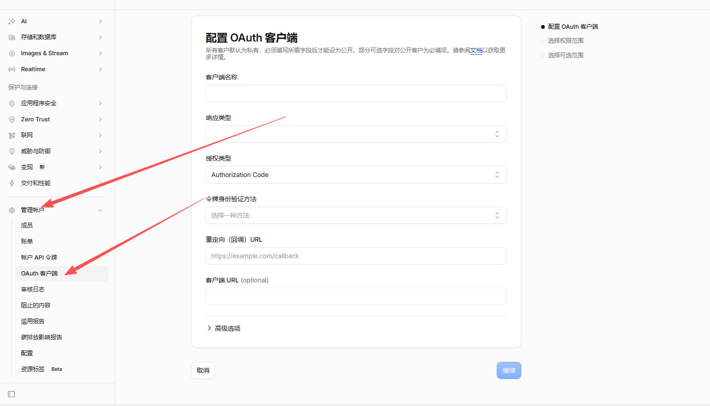
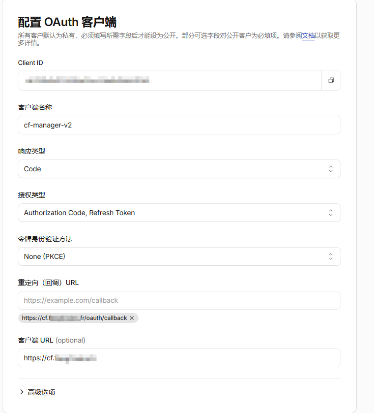
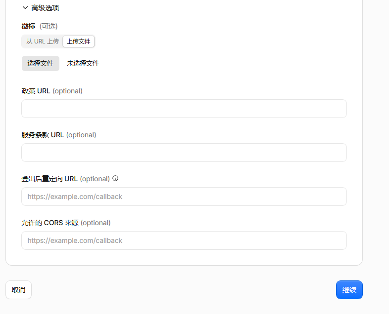
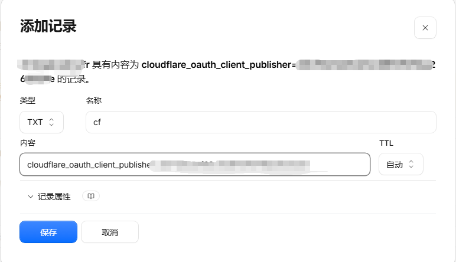
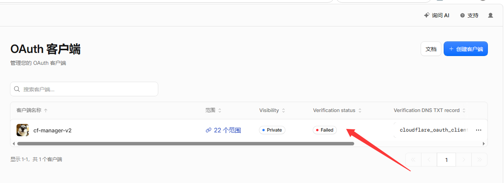
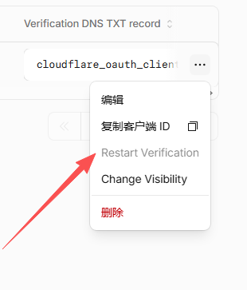
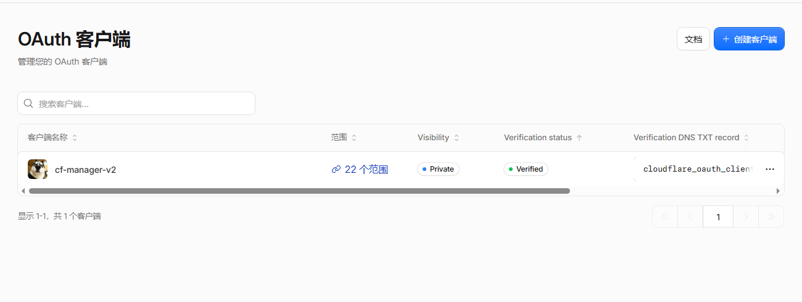
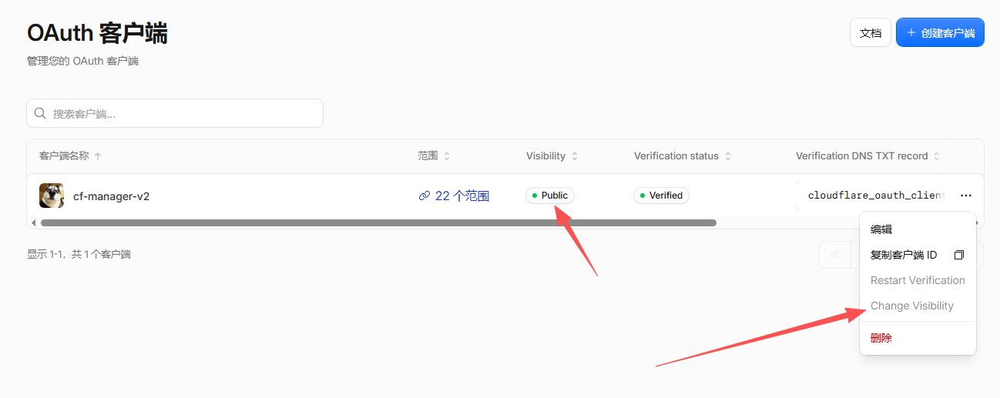
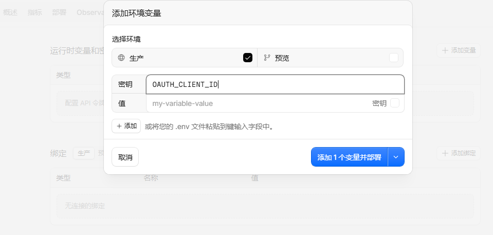
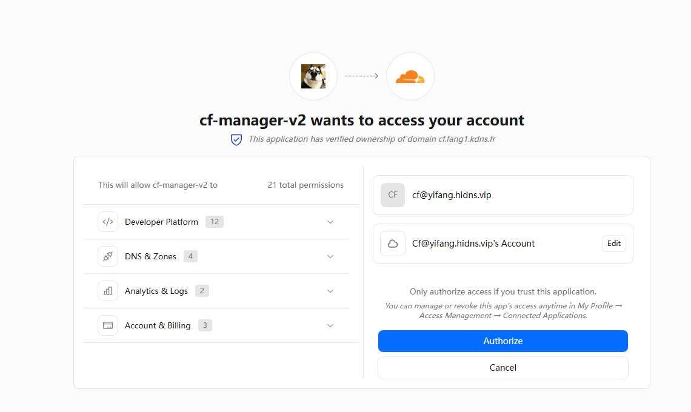

# Cloudflare 管理面板 · OAuth 客户端配置教程

从零创建 → 域名验证 → 设为公开 → 接入面板，全流程图文版。

> 配置完成后，把得到的 **Client ID** 通过环境变量 `OAUTH_CLIENT_ID` 填入 Worker，
> 即可让所有浏览器直接用「使用 Cloudflare 账号登录」登录，无需手动填写。

## 1. 创建 OAuth 客户端

Cloudflare 后台左侧 → **管理帐户** → **OAuth 客户端** → 右上角 **创建客户端**。
按图填写：**客户端名称**（如 cf-manager-v2）、**响应类型**、**授权类型**（Authorization Code）、**令牌身份验证方法**。

## 2. 填写回调地址

关键两项：**重定向（回调）URL** 填 `https://你的面板域名/oauth/callback`（如 `https://cf.example.com/oauth/callback`）；**客户端 URL** 填面板地址。创建后会得到 **Client ID**，先复制保存好。

## 3. 选择权限范围（关键，别漏）

点**继续**进入 **选择权限范围**。注意：界面上显示的是**友好名称**，不是 scope ID。按下面对照表逐行勾选 —— 要 Read 就勾 Read，要 Write 就勾 Edit。

用顶部**搜索框**直接搜更快，比如搜 `workers`、`d1`、`dns`、`Analytics`（搜出来叫 Zone Analytics，勾它）。点开分类逐项勾选，右侧 **32/32** 这种表示该分类已全选。21 个 scope 一键复制（对照用，界面上不用填）：workers-scripts.admin workers-routes.read workers-routes.write workers-tail.read workers-kv-storage.read workers-kv-storage.write d1.read d1.write workers-r2.read workers-r2.write zone.read zone.write dns.read dns.write page.read page.write analytics.read account-analytics.read account-settings.read memberships.read user-details.read

| 界面上的行（搜关键词） | 勾选 | 对应 scope（供对照） |
| --- | --- | --- |
| Workers | Admin 必勾（Content Read、Metadata Read 建议勾） | workers-scripts.admin |
| Workers Routes | Read、Edit | workers-routes.read workers-routes.write |
| Workers Tail | Read | workers-tail.read |
| Workers KV Storage | Read、Edit | workers-kv-storage.read workers-kv-storage.write |
| D1 | Read、Edit | d1.read d1.write |
| Workers R2 Storage | Read、Edit | workers-r2.read workers-r2.write |
| Zone | Read、Edit | zone.read zone.write |
| DNS | Read、Edit | dns.read dns.write |
| Pages | Read、Edit | page.read page.write |
| Zone Analytics | Read | analytics.read |
| Account Analytics | Read | account-analytics.read |
| Account Settings | Read | account-settings.read |
| Memberships | Read | memberships.read |
| User Details | Read | user-details.read |

## 4. 高级选项：上传徽标（想公开必填）

展开 **高级选项** → **徽标**：想把客户端设为 **Public**（所有人可用）必须上传徽标。两种方式：**从 URL 上传** 或 **上传文件**（本地选图）。

## 5. DNS 添加 TXT 验证记录

Cloudflare 会给出一条 TXT 记录（名称类似 `cloudflare_oauth_client_publisher=…`）。去你域名的 **DNS** 里添加这条 **TXT** 记录，TTL 选自动，保存。

## 6. 触发重新验证

回到 OAuth 客户端列表，如果 **Verification status** 显示 **Failed**（红色），点右侧 **…** → **Restart Verification**，触发重新验证。

## 7. 等待状态变为 Verified

TXT 生效后状态会变为 **Verified**（绿色）。如果一直不变，检查 TXT 记录的名称和内容是否完全一致、DNS 是否已生效。

## 8. 改为公开（所有人可登录）

点右侧 **…** → **Change Visibility** → 改为 **Public**。公开后任何 Cloudflare 用户都能用这个客户端给你的面板做 OAuth 登录；保持 Private 则只有你自己能用。

## 9. Worker 添加环境变量

去挂面板域名的 Worker → **Settings → Variables** → **添加环境变量**：名称 `OAUTH_CLIENT_ID`，值填第 2 步复制的 Client ID，环境选 **生产**，保存并部署。

## 10. 最终效果

用户在面板点“使用 Cloudflare 账号登录”，会跳到 Cloudflare 官方授权页，显示 **cf-manager-v2 wants to access your account**，并有 **已验证域名** 徽标，点 Authorize 即完成登录。

---

_教程版本 2026-10-15 · 截图均为实拍_
